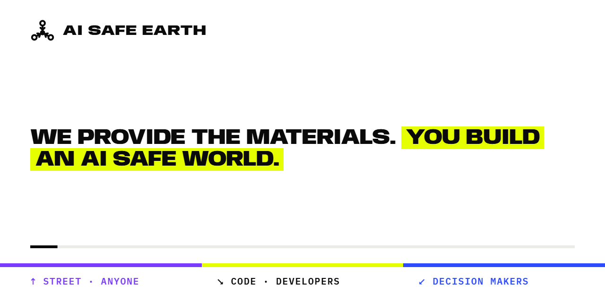
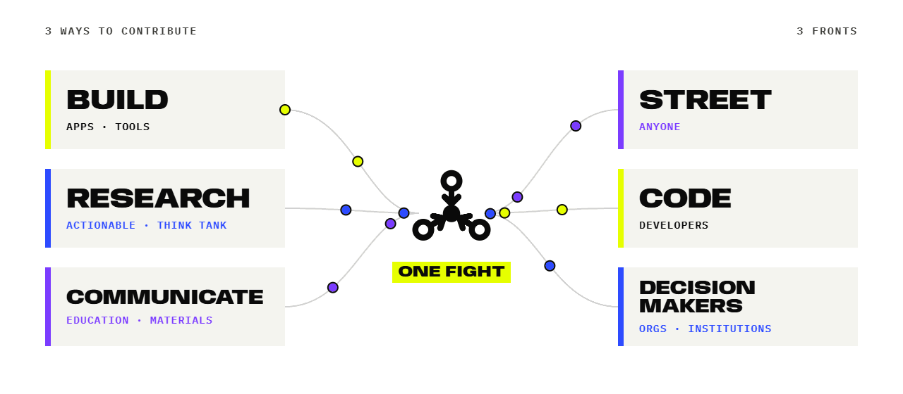
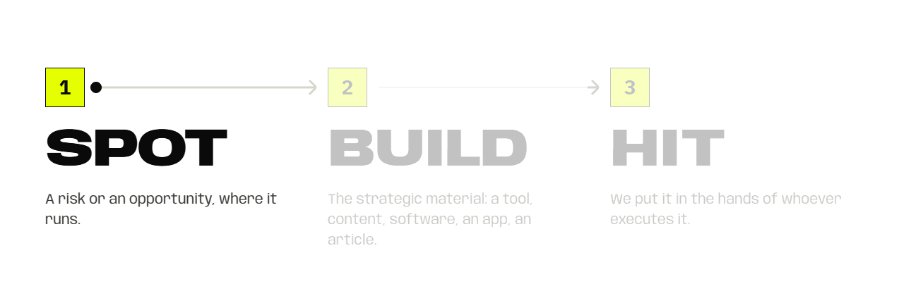

## AI SAFE EARTH

AI SAFE EARTH was born as a response to digital imbalance, under one critical assumption: as digital systems grow more intelligent, that imbalance amplifies disruptive social risks. We have a direct action approach and we believe the community layer is the appropriate one to respond to this humanity challenge.

---

## The problem we refuse to ignore

A digital intermediate layer is thickening between human connections, and the models and agents that manage those connections become more powerful every day. When a single layer mediates how people talk, decide and relate, whoever controls it gains outsized power, and communities lose agency.

The risk is not a distant superintelligence. It has already begun: the slow erosion of human agency and the concentration of power are a nowadays reality.

Some forecasts put transformative AI in years, not decades. We may be unprepared for the effects, and we cannot wait for perfect research or perfect policy. So we treat social infrastructure the way we treat a power grid: as critical infrastructure to be protected and strengthened, urgently, before digital imbalance and advanced AI combine into something we cannot undo.

---

## 3 ways to contribute ---> 3 ways to execute

**Strategic focus: act on the community layer, at scale.** Communities are where AI risk lands and where it can be stopped, so every front works through them.

---

## How we move

**1 · SPOT** a risk or an opportunity.
**2 · BUILD** the strategic material: a tool, content, software, an app, an article.
**3 · HIT.** We put it in the hands of whoever executes it.

---

## 3 WAYS TO CONTRIBUTE

---

## BUILD

This is the action arm. We build safe apps that rebalance digital and physical social interaction and reinforce local communities and social dynamics. Physical and local networks are the safety net. Social infrastructure is critical infrastructure, and we build to make it stronger, fast, before AGI, malicious actors using AI and digital imbalance create a critical combination.

### Tools to make any AI system safer:

#### [AnyAISafe](https://github.com/ai-safe-earth/AnyAISafe)

       

An audit of the intentions built into AI software: the prompts a product gives its model, and the algorithms around them. It does not hunt for errors, failures or unwanted behaviour. It looks for what the system is built to do to the person using it.

### Applications for digital balance:

#### AI against attention economy.
We apply AI to turn the algorithmic loop into a bridge toward real life. We don't use AI as an addictive form of interaction. We use it to bring people back to people or back to real-world interactions, pulling users out of infinite scrolling and dopamine drain and into face-to-face socialising and public life. 

#### [laiive](https://github.com/ai-safe-earth/laiive)

     

A global cultural agenda that connects people with live music in their neighbourhood, in the room. 

#### [VaiVia](https://github.com/ai-safe-earth/VaiVia)

     

VaiVia goal is to make accessible trails, hikes and outdoor routes to anyone.

---

## RESEARCH

#### Research with an actionable approach.

#### [AI Safe Territory](https://github.com/ai-safe-earth/AI-Safe-Territory) *(in progress)*

    

Research into AI-safe towns and cities, and a transparent, reproducible evaluation system that scores and ranks territories on their resilience: distributed decision-making, redundant communication channels (no single point of dependence), local ownership, civic density, AI literacy, and exposure to capture.

The research is published and evolving as a [living book](https://ai-safe-earth.github.io/AI-Safe-Territory/).

#### AI Safe Map *(open)*

 

A map of AI risks and of exposure to them. It works at territorial grain, not country grain, so it sits closer to the impact on each community.

---

## COMMUNICATE

 #### ... to turn evidence into pressure and awareness. 
 This branch creates the materials for AI safety education, in many kinds of programmes and formats. It gives research a punchy shape and supports any action with communication. Using data, real examples and red-teaming scenarios, we build critical mass and move decision-makers to act. We find the gaps between AI risks and people's awareness of them, and close them with effective AI safety literacy.

#### AI Safety for Community Leaders *(in progress)*

 

Practical, accessible programmes and materials for the local leaders who hold communities together. Ready to use in a training session, a meeting or a proposal to a local administration.

#### AI adoption for SMEs and micro businesses: the SAFE way *(open)*

 

Materials that help small and medium enterprises (SMEs) and micro businesses adopt AI the safe way.

---

## Contributing

Build, research or communicate. Start with [contributing](./contributing.md), pick an `OPEN` badge above, or [open an issue](https://github.com/ai-safe-earth/.github/issues) and tell us what you want to do.

---
